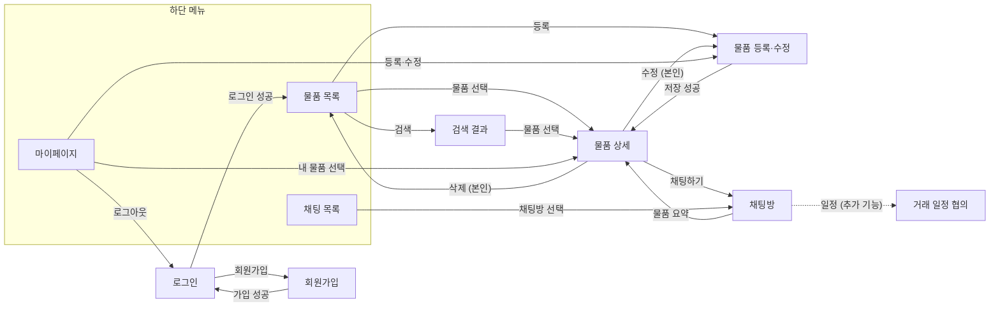

# 중앙대 캠퍼스 마켓 (CAU Market)

> 물건을 처분해야 하는 학생과 물건이 필요한 학생을 연결하는 교내 중고거래 앱

중앙대학교 소프트웨어학부 **모바일 앱 개발** 수업 Term Project (2026)

---

## 목차

1. [기획 목적](#1-기획-목적)
2. [구현 목표](#2-구현-목표)
3. [주요 기능](#3-주요-기능)
4. [화면 구성](#4-화면-구성)
5. [이용 정책](#5-이용-정책)
6. [데이터 구조](#6-데이터-구조)
7. [공통 함수 규격 (Repository)](#7-공통-함수-규격-repository)
8. [기술 스택](#8-기술-스택)
9. [역할 분담](#9-역할-분담)
10. [협의 중인 사항](#10-협의-중인-사항)

---

## 1. 기획 목적

학기 말·졸업·이사 시기마다 캠퍼스에는 처분해야 하는 물건과 그 물건이 필요한 학생이 동시에 생깁니다. 하지만 일반 중고거래 플랫폼은 교내 거래에 맞지 않는 부분이 있습니다.

| 문제 | 캠퍼스 마켓의 접근 |
| --- | --- |
| 상대가 같은 학교 학생인지 알 수 없음 | **학교 이메일(`cau.ac.kr`)로만 가입** |
| 전공 교재·기숙사 생활용품처럼 학교 안에서 수요가 큰 물건이 흩어져 거래됨 | **교재·생활용품·전자기기 등 캠퍼스 맞춤 카테고리** |
| 거래 장소·시간을 정하려면 대화가 길어짐 | **거래 희망 위치 표시**, 채팅 기반 일정 조율 (추가 기능으로 교내 장소·시간 선택) |
| 졸업·이사 등 처분 기한이 있는 물건이 제때 거래되지 않음 | 처분 희망 기한 표시 (추가 기능) |
| 예약 후 거래가 흐지부지되거나 상태가 갱신되지 않음 | **판매 중 · 예약 중 · 거래 완료** 상태 관리 |

**목표:** 같은 캠퍼스의 학생끼리 믿고, 가깝고, 빠르게 거래할 수 있는 환경을 만드는 것입니다.

---

## 2. 구현 목표

### 1차 구현 범위 (필수)

- **회원:** 학교 이메일 도메인 제한 회원가입, 로그인, 로그아웃
- **물품:** 목록 조회, 키워드·카테고리 검색, 상세 조회, 등록·수정·삭제, 거래 상태 변경
- **채팅:** 물품별 1:1 채팅, 텍스트·사진 메시지, 읽음 처리, 안 읽은 메시지 수, 채팅방 나가기
- **마이페이지:** 내 판매 물품 상태별 조회, 계정 정보, 로그아웃
- **공통:** 로딩 · 데이터 없음 · 오류 안내 및 재시도 상태, 저장·전송 중 중복 요청 방지

### 추가 기능 (협의 후 결정)

| 기능 | 내용 |
| --- | --- |
| 거래 일정 협의 | 채팅방에서 교내 장소 + 날짜·시간을 제안·수락·확정·취소 (기본안). 지도·시간표 기반은 확장안 |
| 처분 희망 기한 | 물품 등록 시 날짜 선택, 상세에 표시 |
| 중앙대 학생 인증 | 인증 메일 발송·확인. 미인증 사용자는 목록 조회만 허용 |
| 관심 매물 알림 · 조건 기반 추천 | 품목·가격·수령 가능 날짜에 맞는 매물 추천 및 알림 |
| 묶음 거래 | 여러 물품 묶음 구매 신청 |
| 비밀번호 재설정 | 1차 구현에서 제외, 필요 시 추가 |

### 완료 기준 예시

- 물품을 등록하면 목록에 새 물품이 나타나고, 상세 화면에서 입력한 정보가 그대로 확인된다.
- 다른 사용자의 물품에서 ‘채팅하기’를 누르면 기존 채팅방이 열리거나 새 채팅방이 생성되고, 양쪽에서 메시지가 실시간으로 보인다.
- 거래 완료로 변경한 물품은 기본 목록에서 빠지고 신규 문의가 막히지만, 기존 채팅은 계속 이용할 수 있다.

---

## 3. 주요 기능

### 회원가입·로그인
- `cau.ac.kr` 도메인 이메일만 가입 허용 (이메일 형식·도메인 검사)
- 닉네임, 비밀번호·비밀번호 확인 일치 검사
- 가입 성공 시 로그인 화면으로 이동
- 로그인 성공 시 물품 목록으로 이동 (뒤로 가기로 로그인 화면 복귀 불가)
- 입력 누락·계정 정보 불일치·네트워크 오류 안내, 처리 중 버튼 비활성화

### 물품 목록·검색
- 최근 등록순 표시 (별도 정렬 메뉴 없음)
- 기본 목록은 **거래 완료 물품 제외**
- 제목 + 설명 대상 키워드 검색, 카테고리 필터 (전체·교재·생활용품·전자기기 등)
- 검색 결과에는 거래 완료 물품도 포함하며, **‘거래 완료 제외’ 옵션** 제공
- 새로고침, 빈 목록 안내, 물품 등록 버튼

### 물품 상세
- 사진 여러 장 넘겨 보기·확대, 제목·가격(무료는 ‘나눔’), 거래 상태, 카테고리·물품 상태·설명
- 판매자 닉네임, 거래 희망 위치
- 본인 여부·거래 상태에 따른 하단 버튼

| 상황 | 버튼 |
| --- | --- |
| 다른 사람의 판매 중·예약 중 물품 | **채팅하기** (예약 중에도 문의 가능) |
| 본인 물품 | **수정 / 삭제** (삭제 전 확인창) |
| 거래 완료 물품 | 신규 문의 불가 (버튼 비활성화) |

### 물품 등록·수정
- 등록·수정은 같은 화면을 재사용하고, 수정 시 기존 내용을 미리 채움
- 사진 **최소 1장 · 최대 15장**, 추가한 순서대로 표시, 첫 번째 사진이 대표 사진 (순서 변경 없음)
- 제목 **최대 50자**, 설명 **최대 1,000자** (현재 글자 수 표시)
- 카테고리, 가격(숫자), 무료 나눔(0원 처리), 물품 상태, 거래 희망 위치
- 수정 화면에서 거래 상태(판매 중·예약 중·거래 완료) 변경 — 모든 상태 간 변경·복구 허용
- 저장 성공 시 해당 물품 상세로 이동, 저장 중 중복 요청 방지, 작성 중 나가기 확인

### 채팅 목록
- 상대방 닉네임, 연결된 물품의 대표 사진·물품명, 마지막 메시지(사진이면 ‘사진’)와 시간
- 안 읽은 메시지 수: 99개까지 숫자, 100개 이상은 **‘99+’**
- 채팅방 나가기, 빈 목록 안내

### 채팅방
- 물품 요약(대표 사진·물품명·가격·거래 상태) → 선택 시 물품 상세로 이동
- 내/상대 메시지 구분, 날짜 구분선, 전송 시간
- 텍스트 메시지(빈 메시지 전송 방지), **사진 한 번에 최대 10장** 전송, 사진 확대
- 전송 중·실패 표시 및 재시도
- 읽음 표시 (채팅방 진입 시 읽음 처리)
- 거래 완료 후에도 기존 대화 유지

### 마이페이지
- 계정 정보(닉네임·이메일), 로그아웃
- 내 판매 물품: 전체·판매 중·예약 중·거래 완료 탭
- 물품 선택 → 본인 물품 상세, 수정 버튼 → 수정 화면, 등록 버튼 → 등록 화면

### 거래 일정 협의 (추가 기능)
- 채팅방에서 진입, 거래 물품·상대 정보 표시
- 교내 장소 목록 선택 + 장소 상세, 날짜·시간, 메모 입력
- 일정 제안 → 상대방 수락 또는 변경 제안 → 확정 일정 표시, 제안·확정 일정 취소

---

## 4. 화면 구성

| 구분 | 화면 | 하단 메뉴 |
| --- | --- | --- |
| 인증 | 로그인, 회원가입 | 숨김 |
| 메인 탭 | 물품 목록, 채팅 목록, 마이페이지 | **표시** |
| 상세·입력 | 물품 상세, 물품 등록·수정, 채팅방, 거래 일정 협의 | 숨김 |

### 화면 흐름

와이어프레임(화면 구성안)은 Figma에서 관리합니다: [중고거래 앱 화면 구성안](https://www.figma.com/design/4ncQh9GKcni10UphFZcZjw) (팀원 공유 필요)

---

## 5. 이용 정책

| 구분 | 가입 조건 | 거래 기능 이용 조건 |
| --- | --- | --- |
| 초기 버전 | `cau.ac.kr` 학교 이메일로 가입 | 로그인 성공 시 거래 허용 (이메일 소유 인증 없음) |
| 이메일 인증 도입 후 | 학교 이메일 가입 + 인증 절차 | 인증 완료 후 거래 허용, 미인증 사용자는 물품 목록만 조회 |

> 도메인 제한만으로는 이메일 소유나 학생 신분이 확인되지 않습니다. 실제 소유 인증은 추가 기능으로 구분합니다.

**거래 상태**

- 판매자 본인이 물품 수정 화면에서 판매 중·예약 중·거래 완료 간 자유롭게 변경·복구
- 예약 중은 구매자를 지정하지 않고 상태만 표시
- 거래 완료: 기본 목록에서 제외, 신규 문의 제한, 기존 채팅은 유지
- 거래 완료 → 판매 중/예약 중 복구 시 기본 목록에 다시 표시되고 신규 문의 가능

**채팅**

- 읽음 처리: 채팅방에 진입해 메시지를 정상적으로 불러온 시점까지의 수신 메시지 (목록 표시·푸시 도착만으로는 읽음 처리하지 않음)
- 채팅방 나가기: 나간 사람의 목록·대화 화면에서만 제거하고 이후 새 메시지를 수신하지 않음. 새 메시지로 방이 자동 복원되지 않으며, 상대방의 대화 기록은 유지

---

## 6. 데이터 구조

> 초안입니다. 필드 이름·자료형·필수 여부는 팀 합의 후 확정합니다.

| 데이터 | 의미 | 주요 필드 |
| --- | --- | --- |
| `User` | 사용자 | `userId`, `email`, `nickname`, `createdAt` |
| `Product` | 판매 물품 | `productId`, `sellerId`, `title`, `price`, `description`, `category`, `condition`, `imageUrls`, `status`, `createdAt` |
| `ChatRoom` | 채팅방 | `chatId`, `productId`, `buyerId`, `sellerId`, `createdAt` |
| `Message` | 채팅 메시지 | `messageId`, `chatId`, `senderId`, `text`, `createdAt` |

함께 정할 공통 규칙: 가격 표현(원 단위 정수, 무료 나눔), 날짜·시간 저장 형식, ID 생성 방식, 선택 입력값의 null/빈 값 기준, 거래 상태 내부 값, 사진 저장 값(Storage 경로 vs URL).

---

## 7. 공통 함수 규격 (Repository)

화면 담당자가 호출할 함수의 입력·출력을 먼저 합의하고, 데이터 담당자가 실제 연동을 구현합니다. (초안)

| 기능 | 함수 | 입력 | 결과 |
| --- | --- | --- | --- |
| 회원가입 | `signUp` | 이메일, 비밀번호, 닉네임 | 가입 결과 |
| 로그인 | `login` | 이메일, 비밀번호 | 로그인 사용자 정보 |
| 로그아웃 | `logout` | — | 완료 결과 |
| 목록 조회 | `getProducts` | 검색어, 카테고리, 조건 | 물품 목록 |
| 상세 조회 | `getProduct` | 물품 ID | 물품 상세 |
| 물품 등록 | `createProduct` | 물품 정보, 선택한 사진 | 생성된 물품 ID |
| 물품 수정 | `updateProduct` | 물품 ID, 수정 정보 | 완료 결과 |
| 물품 삭제 | `deleteProduct` | 물품 ID | 완료 결과 |
| 거래 상태 변경 | `changeProductStatus` | 물품 ID, 변경할 상태 | 변경 결과 |
| 채팅방 목록 | `observeChatRooms` | 로그인 사용자 기준 | 실시간 채팅방 목록 |
| 채팅방 열기 | `getOrCreateChatRoom` | 물품 ID | 기존 또는 새 채팅방 ID |
| 메시지 전송 | `sendMessage` | 채팅방 ID, 메시지 내용 | 전송 결과 |
| 메시지 수신 | `observeMessages` | 채팅방 ID | 실시간 메시지 목록 |

---

## 8. 기술 스택

| 영역 | 사용 기술 |
| --- | --- |
| 플랫폼 | Android |
| 언어 | Kotlin |
| 백엔드 | Firebase (Authentication, Cloud Firestore, Storage) |
| 디자인 | Figma |
| 협업 | GitHub |

> 세부 라이브러리와 아키텍처는 개발을 시작하며 추가합니다.

---

## 9. 역할 분담

| 역할 | 담당 범위 | 담당자 |
| --- | --- | --- |
| UI/UX | 화면 디자인, 이동 흐름, 로딩·오류·빈 화면 설계 | 협의 중 |
| 프론트엔드 | 화면 구현, 입력 처리, 화면 상태 관리, Repository 호출 | 협의 중 |
| 백엔드·데이터 연동 | Firebase 설정, 공통 데이터, Repository 구현, DB·Storage 접근 권한 | 협의 중 |
| 공동 | 데이터·함수 규격 합의, 통합 확인 | 전원 |

---

## 10. 협의 중인 사항

- 사진 외 필수 입력 항목 (제목·설명·가격·카테고리·거래 희망 위치)
- 거래 희망 위치: 자유 텍스트 vs 교내 장소 목록 선택
- 첫 번째 사진 삭제 시 대표 사진 처리
- 채팅방 읽음 표시 모양, 방에 머무는 동안 받은 메시지의 읽음 처리
- 채팅방 나가기 버튼 위치·확인창, 상대방 안내 여부, 나간 방 재진입 정책
- 거래 상태 변경 시 확인창 여부
- 거래 일정 협의 기능의 구현 범위 (기본안 / 지도 / 시간표), 일정 확정과 ‘예약 중’ 상태 연동 여부
- 동일 물품·구매자의 중복 채팅방 허용 여부
