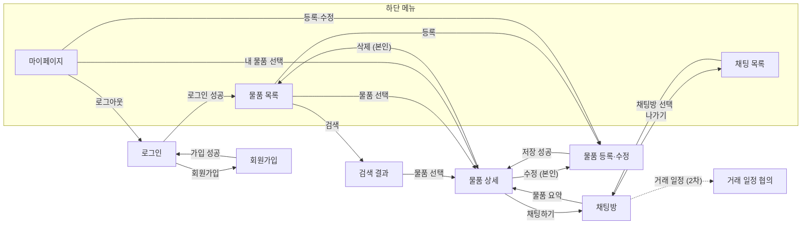

# 중앙대 캠퍼스 마켓 (CAU Market)

> 물건을 처분해야 하는 학생과 물건이 필요한 학생을 연결하는 교내 중고거래 앱

중앙대학교 소프트웨어학부 **모바일 앱 개발** 수업 Term Project (2026)

| 역할 | 이름 |
| --- | --- |
| UI/UX | 정소은 |
| 프론트엔드 | 이병현 |
| 백엔드·데이터 연동 | 정재훈 |

---

## 목차

1. [기획 목적](#1-기획-목적)
2. [구현 목표](#2-구현-목표)
3. [주요 기능](#3-주요-기능)
4. [화면 구성](#4-화면-구성)
5. [이용 정책](#5-이용-정책)
6. [데이터 구조](#6-데이터-구조)
7. [공통 함수 규격 (Repository)](#7-공통-함수-규격-repository)
8. [기술 스택](#8-기술-스택)
9. [역할 분담](#9-역할-분담)
10. [결정 사항](#10-결정-사항)

---

## 1. 기획 목적

학기 말·졸업·이사 시기마다 캠퍼스에는 처분해야 하는 물건과 그 물건이 필요한 학생이 동시에 생깁니다. 하지만 일반 중고거래 플랫폼은 교내 거래에 맞지 않는 부분이 있습니다.

| 문제 | 캠퍼스 마켓의 접근 |
| --- | --- |
| 상대가 같은 학교 학생인지 알 수 없음 | **학교 이메일(`cau.ac.kr`)로만 가입** |
| 전공 교재·기숙사 생활용품처럼 학교 안에서 수요가 큰 물건이 흩어져 거래됨 | **교재·생활용품·전자기기 등 캠퍼스 맞춤 카테고리** |
| 거래 장소를 정하려면 대화가 길어짐 | **교내 장소 목록에서 거래 희망 위치 선택** |
| 졸업·이사 등 처분 기한이 있는 물건이 제때 거래되지 않음 | **처분 희망 기한 표시** |
| 예약 후 거래가 흐지부지되거나 상태가 갱신되지 않음 | **판매 중 · 예약 중 · 거래 완료** 상태 관리 |

**목표:** 같은 캠퍼스의 학생끼리 믿고, 가깝고, 빠르게 거래할 수 있는 환경을 만드는 것입니다.

---

## 2. 구현 목표

### 1차 구현 범위 (필수)

- **회원:** 학교 이메일 도메인 제한 회원가입, 로그인, 로그아웃
- **물품:** 목록 조회, 키워드·카테고리 검색, 상세 조회, 등록·수정·삭제, 거래 상태 변경, 거래 희망 위치·처분 희망 기한
- **채팅:** 물품별 1:1 채팅, 텍스트·사진 메시지, 읽음 표시, 안 읽은 메시지 수, 채팅방 나가기
- **마이페이지:** 내 판매 물품 상태별 조회, 계정 정보, 로그아웃
- **공통:** 로딩 · 데이터 없음 · 오류 안내 및 재시도 상태, 저장·전송 중 중복 요청 방지

### 2차 구현 범위 (1차 완료 후)

- **거래 일정 협의 (기본안):** 채팅방에서 교내 장소 + 날짜·시간을 제안·수락·확정·취소

### 구현하지 않는 범위

이번 학기에는 아래 기능을 구현하지 않고, 시간이 남으면 위에서부터 검토합니다.

- 이메일 소유 인증(중앙대 학생 인증), 비밀번호 재설정
- 관심 매물 알림 · 조건 기반 추천, 푸시 알림
- 묶음 거래
- 지도·시간표 기반 일정 협의

### 완료 기준

- 물품을 등록하면 목록에 새 물품이 나타나고, 상세 화면에서 입력한 정보가 그대로 확인된다.
- 다른 사용자의 물품에서 ‘채팅하기’를 누르면 기존 채팅방이 열리거나 새 채팅방이 생성되고, 양쪽에서 메시지가 실시간으로 보인다.
- 상대가 채팅방에 들어오면 내 메시지의 안 읽음 표시가 사라지고, 채팅 목록의 안 읽은 수가 0이 된다.
- 거래 완료로 변경한 물품은 기본 목록에서 빠지고 신규 문의가 막히지만, 기존 채팅은 계속 이용할 수 있다.

---

## 3. 주요 기능

### 회원가입·로그인
- `cau.ac.kr` 도메인 이메일만 가입 허용 (이메일 형식·도메인 검사)
- 닉네임(2~10자), 비밀번호(8자 이상)·비밀번호 확인 일치 검사
- 가입 성공 시 로그인 화면으로 이동
- 로그인 성공 시 물품 목록으로 이동 (뒤로 가기로 로그인 화면 복귀 불가)
- 입력 누락·계정 정보 불일치·네트워크 오류 안내, 처리 중 버튼 비활성화

### 물품 목록·검색
- 최근 등록순 표시 (별도 정렬 메뉴 없음)
- 기본 목록은 **거래 완료 물품 제외**
- 제목 + 설명 대상 키워드 검색, 카테고리 필터
- 검색 결과에는 거래 완료 물품도 포함하며, **‘거래 완료 제외’ 옵션** 제공
- 새로고침, 빈 목록 안내, 물품 등록 버튼

### 물품 상세
- 사진 여러 장 넘겨 보기·확대, 제목·가격(0원은 ‘나눔’), 거래 상태, 카테고리·물품 상태·설명
- 판매자 닉네임, 거래 희망 위치, 처분 희망 기한(입력한 경우)
- 본인 여부·거래 상태에 따른 하단 버튼

| 상황 | 버튼 |
| --- | --- |
| 다른 사람의 판매 중·예약 중 물품 | **채팅하기** (예약 중에도 문의 가능) |
| 본인 물품 | **수정 / 삭제** (삭제 전 확인창) |
| 거래 완료 물품 (다른 사람) | 신규 문의 불가 (버튼 비활성화) |

### 물품 등록·수정
- 등록·수정은 같은 화면을 재사용하고, 수정 시 기존 내용을 미리 채움
- 사진 **최소 1장 · 최대 15장**, 추가한 순서대로 표시, 첫 번째 사진이 대표 사진 (순서 변경 없음)
- 제목 **최대 50자**, 설명 **최대 1,000자** (현재 글자 수 표시)
- 카테고리, 가격(숫자), 무료 나눔(0원 처리), 물품 상태, 거래 희망 위치, 처분 희망 기한
- 수정 화면에서 거래 상태(판매 중·예약 중·거래 완료) 변경 — 모든 상태 간 변경·복구 허용
- 저장 성공 시 해당 물품 상세로 이동, 저장 중 중복 요청 방지, 작성 중 나가기 확인

| 입력 항목 | 필수 | 제한 |
| --- | --- | --- |
| 사진 | 필수 | 1~15장 |
| 제목 | 필수 | 1~50자 |
| 카테고리 | 필수 | 교재 · 생활용품 · 전자기기 · 의류 · 기타 |
| 가격 | 필수 | 0 ~ 10,000,000원 정수, 무료 나눔 선택 시 0원 |
| 물품 상태 | 필수 | 새 상품 · 사용감 적음 · 사용감 많음 · 하자 있음 |
| 거래 희망 위치 | 필수 | 교내 장소 목록에서 선택 + 상세 설명(선택, 최대 30자) |
| 설명 | 선택 | 최대 1,000자 |
| 처분 희망 기한 | 선택 | 오늘 이후 날짜 |

### 채팅 목록
- 상대방 닉네임, 연결된 물품의 대표 사진·물품명, 마지막 메시지(사진이면 ‘사진’)와 시간
- 안 읽은 메시지 수: 99개까지 숫자, 100개 이상은 **‘99+’**
- 최근 메시지순 정렬, 빈 목록 안내

### 채팅방
- 물품 요약(대표 사진·물품명·가격·거래 상태) → 선택 시 물품 상세로 이동
- 내/상대 메시지 구분, 날짜 구분선, 전송 시간
- 텍스트 메시지(빈 메시지 전송 방지, 최대 1,000자), **사진 한 번에 최대 10장** 전송, 사진 확대
- 전송 중·실패 표시 및 재시도
- 읽음 표시: 상대가 아직 읽지 않은 내 메시지 옆에 **‘1’** 표시, 읽으면 사라짐
- 상단 **⋯ 메뉴 → 채팅방 나가기** (확인창)
- 거래 완료 후에도 기존 대화 유지

### 마이페이지
- 계정 정보(닉네임·이메일), 로그아웃 (확인창)
- 내 판매 물품: 전체·판매 중·예약 중·거래 완료 탭
- 물품 선택 → 본인 물품 상세, 수정 버튼 → 수정 화면, 등록 버튼 → 등록 화면

### 거래 일정 협의 (2차)
- 채팅방 상단의 ‘거래 일정’ 버튼으로 진입
- 교내 장소 목록 선택 + 장소 상세, 날짜·시간, 메모 입력
- 일정 제안 → 상대방 수락 또는 변경 제안 → 확정 → 필요 시 취소
- 제안·확정·취소는 채팅방에 일정 안내 카드로 표시

---

## 4. 화면 구성

| 구분 | 화면 | 하단 메뉴 |
| --- | --- | --- |
| 인증 | 로그인, 회원가입 | 숨김 |
| 메인 탭 | 물품 목록, 채팅 목록, 마이페이지 | **표시** |
| 상세·입력 | 물품 상세, 물품 등록·수정, 채팅방, 거래 일정 협의 | 숨김 |

### 화면 흐름

와이어프레임(화면 구성안)은 Figma에서 관리합니다: [중고거래 앱 화면 구성안](https://www.figma.com/design/4ncQh9GKcni10UphFZcZjw) (팀원 공유 필요)

---

## 5. 이용 정책

### 가입·이용

| 구분 | 가입 조건 | 거래 기능 이용 조건 |
| --- | --- | --- |
| 1차 버전 | `cau.ac.kr` 학교 이메일로 가입 | 로그인 성공 시 거래 허용 (이메일 소유 인증 없음) |
| 이메일 인증 도입 시 | 학교 이메일 가입 + 인증 절차 | 인증 완료 후 거래 허용, 미인증 사용자는 물품 목록만 조회 |

> 도메인 제한만으로는 이메일 소유나 학생 신분이 확인되지 않습니다. 실제 소유 인증은 구현하지 않는 범위로 구분합니다.

### 거래 상태

- 판매자 본인만 물품 수정 화면에서 판매 중·예약 중·거래 완료 간 자유롭게 변경·복구
- 예약 중은 구매자를 지정하지 않고 상태만 표시
- **거래 완료로 바꿀 때만 확인창** 표시 (다른 변경은 바로 저장)
- 거래 완료: 기본 목록에서 제외, 신규 문의 제한, 기존 채팅은 유지
- 거래 완료 → 판매 중/예약 중 복구 시 기본 목록에 다시 표시되고 신규 문의 가능
- 물품 삭제 시 연결된 채팅방은 유지하되, 물품 요약에 ‘삭제된 물품’으로 표시

### 채팅

- **채팅방 단위:** 같은 물품·같은 구매자 조합에는 양쪽이 모두 참여 중인 채팅방을 하나만 둠. ‘채팅하기’를 누르면 그 방을 열고, 없으면 새로 만듦
- **읽음 처리:** 채팅방 화면이 열려 있는 동안 도착한 메시지까지 모두 읽음 처리. 채팅 목록 표시나 알림 도착만으로는 읽음 처리하지 않음
- **나가기:** 채팅방 ⋯ 메뉴에서 확인 후 실행
  - 나간 사람의 목록·대화 화면에서 제거, 이후 새 메시지를 받지 않으며 방이 자동 복원되지 않음
  - 상대방 화면에는 기존 기록을 유지하고 **‘상대방이 채팅방을 나갔습니다’** 안내를 표시하며, 입력창을 비활성화
  - 같은 물품에서 다시 ‘채팅하기’를 누르면 **새 채팅방**이 생성되고 이전 기록은 보이지 않음
  - 거래 완료 물품은 ‘채팅하기’가 비활성화되므로 새 채팅방을 만들 수 없음

### 거래 일정 (2차)

- 일정 제안·변경·취소 전 확인창 표시, 결과는 채팅방 일정 안내 카드로 상대에게 전달 (푸시 알림 없음)
- 일정 확정과 ‘예약 중’ 상태는 자동 연동하지 않음 — 판매자가 직접 변경

---

## 6. 데이터 구조

Cloud Firestore 컬렉션 기준입니다.

### 공통 규칙

| 항목 | 규칙 |
| --- | --- |
| ID | `userId`는 Firebase Auth UID, 나머지는 Firestore 자동 생성 문서 ID |
| 가격 | 원 단위 `Int`, 무료 나눔은 `0` (화면에 ‘나눔’ 표시) |
| 날짜·시간 | Firestore `Timestamp`로 저장, 서버 시간(`serverTimestamp`) 사용 |
| 시간 표시 | 오늘: `오후 3:20` / 어제: `어제` / 그 이전: `11월 20일` / 다른 해: `2025.11.20` |
| 선택 입력값 | 값이 없으면 `null`, 목록은 빈 리스트 `[]` (빈 문자열 사용 안 함) |
| 사진 | Storage `products/{productId}/{index}.jpg`, `chats/{chatId}/{messageId}_{index}.jpg`에 업로드 후 다운로드 URL을 저장 |
| 열거형 값 | 아래 대문자 영문 값으로 저장하고 화면에서 한글로 변환 |

| 열거형 | 값 |
| --- | --- |
| 거래 상태 `status` | `SELLING` 판매 중 · `RESERVED` 예약 중 · `SOLD` 거래 완료 |
| 카테고리 `category` | `TEXTBOOK` 교재 · `LIVING` 생활용품 · `ELECTRONICS` 전자기기 · `CLOTHING` 의류 · `ETC` 기타 |
| 물품 상태 `condition` | `NEW` 새 상품 · `GOOD` 사용감 적음 · `USED` 사용감 많음 · `DEFECTIVE` 하자 있음 |
| 교내 장소 `place` | `MAIN_GATE` 정문 · `BACK_GATE` 후문 · `LIBRARY` 중앙도서관 · `STUDENT_HALL` 학생회관 · `DORMITORY` 기숙사 · `ETC` 기타 |
| 메시지 종류 `type` | `TEXT` · `IMAGE` · `SYSTEM` |

### `users/{userId}`

| 필드 | 자료형 | 필수 | 설명 |
| --- | --- | --- | --- |
| `userId` | `String` | ✓ | Auth UID |
| `email` | `String` | ✓ | `@cau.ac.kr` 주소 |
| `nickname` | `String` | ✓ | 2~10자 |
| `createdAt` | `Timestamp` | ✓ | 가입 시각 |

### `products/{productId}`

| 필드 | 자료형 | 필수 | 설명 |
| --- | --- | --- | --- |
| `productId` | `String` | ✓ | 문서 ID |
| `sellerId` | `String` | ✓ | 판매자 `userId` |
| `sellerNickname` | `String` | ✓ | 목록·상세 표시용 |
| `title` | `String` | ✓ | 1~50자 |
| `description` | `String?` | | 최대 1,000자 |
| `price` | `Int` | ✓ | 0 = 나눔 |
| `category` | `String` | ✓ | 카테고리 값 |
| `condition` | `String` | ✓ | 물품 상태 값 |
| `imageUrls` | `List<String>` | ✓ | 1~15개, 0번이 대표 사진 |
| `place` | `String` | ✓ | 교내 장소 값 |
| `placeDetail` | `String?` | | 최대 30자 |
| `disposeBy` | `Timestamp?` | | 처분 희망 기한 |
| `status` | `String` | ✓ | 기본값 `SELLING` |
| `createdAt` | `Timestamp` | ✓ | 등록 시각 (정렬 기준) |
| `updatedAt` | `Timestamp` | ✓ | 마지막 수정 시각 |

### `chatRooms/{chatId}`

| 필드 | 자료형 | 필수 | 설명 |
| --- | --- | --- | --- |
| `chatId` | `String` | ✓ | 문서 ID |
| `productId` | `String` | ✓ | 연결된 물품 |
| `sellerId` / `buyerId` | `String` | ✓ | 참여자 |
| `activeUserIds` | `List<String>` | ✓ | 나가지 않은 참여자 (목록 조회 기준) |
| `lastMessage` | `String?` | | 사진이면 `"사진"` |
| `lastMessageAt` | `Timestamp?` | | 목록 정렬 기준 |
| `unreadCount` | `Map<String, Int>` | ✓ | 사용자별 안 읽은 수 |
| `lastReadAt` | `Map<String, Timestamp>` | ✓ | 사용자별 마지막 읽은 시각 (읽음 표시 기준) |
| `createdAt` | `Timestamp` | ✓ | 생성 시각 |

### `chatRooms/{chatId}/messages/{messageId}`

| 필드 | 자료형 | 필수 | 설명 |
| --- | --- | --- | --- |
| `messageId` | `String` | ✓ | 문서 ID |
| `senderId` | `String` | ✓ | `SYSTEM`이면 `"system"` |
| `type` | `String` | ✓ | 메시지 종류 값 |
| `text` | `String?` | | `TEXT`·`SYSTEM`일 때 |
| `imageUrls` | `List<String>` | | `IMAGE`일 때 1~10개 |
| `createdAt` | `Timestamp` | ✓ | 전송 시각 |

### 검색 방식

Firestore는 전문 검색을 지원하지 않으므로, 최근 등록순으로 물품을 불러온 뒤 **앱에서 제목·설명에 검색어가 포함되는지 필터링**합니다. 사용자 수가 수업 프로젝트 규모이므로 충분하며, 물품이 많아지면 페이지 단위로 불러옵니다.

---

## 7. 공통 함수 규격 (Repository)

화면 담당(이병현)이 호출할 함수의 입력·출력을 먼저 합의하고, 데이터 담당(정재훈)이 실제 연동을 구현합니다. 모든 함수는 `suspend` 함수 또는 `Flow`이며, 실패는 `Result`로 전달합니다.

| 기능 | 함수 | 입력 | 결과 |
| --- | --- | --- | --- |
| 회원가입 | `signUp` | 이메일, 비밀번호, 닉네임 | `Result<Unit>` |
| 로그인 | `login` | 이메일, 비밀번호 | `Result<User>` |
| 로그아웃 | `logout` | — | `Result<Unit>` |
| 목록 조회 | `getProducts` | 검색어?, 카테고리?, 거래 완료 포함 여부 | `Result<List<Product>>` |
| 내 물품 조회 | `getMyProducts` | 거래 상태? | `Result<List<Product>>` |
| 상세 조회 | `getProduct` | 물품 ID | `Result<Product>` |
| 물품 등록 | `createProduct` | 물품 입력 정보, 사진 `Uri` 목록 | `Result<String>` (물품 ID) |
| 물품 수정 | `updateProduct` | 물품 ID, 수정 정보, 사진 목록 | `Result<Unit>` |
| 물품 삭제 | `deleteProduct` | 물품 ID | `Result<Unit>` |
| 거래 상태 변경 | `changeProductStatus` | 물품 ID, 상태 | `Result<Unit>` |
| 채팅방 목록 | `observeChatRooms` | — (로그인 사용자 기준) | `Flow<List<ChatRoom>>` |
| 채팅방 열기 | `getOrCreateChatRoom` | 물품 ID | `Result<String>` (채팅방 ID) |
| 메시지 수신 | `observeMessages` | 채팅방 ID | `Flow<List<Message>>` |
| 텍스트 전송 | `sendMessage` | 채팅방 ID, 텍스트 | `Result<Unit>` |
| 사진 전송 | `sendImages` | 채팅방 ID, 사진 `Uri` 목록(최대 10) | `Result<Unit>` |
| 읽음 처리 | `markAsRead` | 채팅방 ID | `Result<Unit>` |
| 채팅방 나가기 | `leaveChatRoom` | 채팅방 ID | `Result<Unit>` |

---

## 8. 기술 스택

| 영역 | 사용 기술 |
| --- | --- |
| 플랫폼 | Android |
| 언어 | Kotlin |
| 백엔드 | Firebase (Authentication, Cloud Firestore, Storage) |
| 디자인 | Figma |
| 협업 | GitHub |

> 세부 라이브러리와 아키텍처는 개발을 시작하며 추가합니다.

---

## 9. 역할 분담

| 역할 | 담당자 | 담당 범위 |
| --- | --- | --- |
| UI/UX | **정소은** | Figma 화면 디자인, 이동 흐름, 로딩·오류·빈 화면 설계, 공통 색상·글꼴·컴포넌트 규칙 |
| 프론트엔드 | **이병현** | 화면 구현, 입력 검증, 화면 상태(로딩·빈·오류) 관리, 화면 이동, Repository 호출 |
| 백엔드·데이터 연동 | **정재훈** | Firebase 프로젝트 설정, 데이터 모델, Repository 구현, Firestore·Storage 보안 규칙, 이미지 업로드, 실시간 채팅 |
| 공동 | 전원 | 데이터·함수 규격 합의, 통합 테스트, 발표 준비 |

규격(데이터 구조·함수)을 바꿀 때는 이 README를 먼저 수정한 뒤 팀에 공유합니다.

---

## 10. 결정 사항

기획 단계에서 협의가 필요했던 항목의 결정 내용입니다.

| 항목 | 결정 | 이유 |
| --- | --- | --- |
| 필수 입력 항목 | 사진·제목·카테고리·가격·물품 상태·거래 희망 위치는 필수, 설명·처분 희망 기한은 선택 | 목록·상세에 꼭 보여야 하는 정보만 필수로 두어 등록 부담을 줄임 |
| 거래 희망 위치 입력 방식 | 교내 장소 목록 선택 + 상세 설명(선택) | 표기가 통일되고, 2차 일정 협의 기능의 장소 목록을 그대로 재사용 |
| 첫 번째 사진 삭제 | 남은 사진 중 첫 번째가 자동으로 대표 사진 | 순서 변경 기능이 없으므로 가장 단순한 규칙 |
| 삭제 버튼 위치 | 물품 상세(본인)에만 배치, 수정 화면에는 없음 | 수정 중 실수로 삭제하는 것을 방지 |
| 수정 화면 진입 | 본인 물품 상세의 ‘수정’, 마이페이지 물품 항목의 ‘수정’ | 판매자가 자주 쓰는 두 경로 모두 제공 |
| 거래 상태 변경 확인창 | 거래 완료로 바꿀 때만 표시 | 목록에서 사라지고 문의가 막히는 변경만 확인 |
| 처분 희망 기한 | 1차 범위에 선택 입력으로 포함 | 기획 핵심(졸업·이사 물품)과 관련 있고 구현 비용이 낮음 |
| 읽음 표시 모양 | 상대가 읽지 않은 내 메시지 옆에 ‘1’ | 사용자에게 익숙한 방식이고 `lastReadAt` 하나로 계산 가능 |
| 채팅방에 머무는 동안 온 메시지 | 화면이 열려 있으면 즉시 읽음 처리 | 보고 있는 메시지가 안 읽음으로 남지 않게 함 |
| 나가기 버튼 위치 | 채팅방 상단 ⋯ 메뉴, 실행 전 확인창 | 목록에서의 실수 조작 방지, 화면 구성이 단순 |
| 나간 뒤 상대방 처리 | ‘상대방이 채팅방을 나갔습니다’ 안내 + 입력창 비활성화 | 받을 사람이 없는 메시지 전송을 막음 |
| 나간 방 재진입 | 재진입 없음, 다시 ‘채팅하기’ 시 새 채팅방 생성 (이전 기록 미표시) | 나가기 정책(기록 제거)과 일관되고 구현이 단순 |
| 중복 채팅방 | 같은 물품·구매자 조합에 활성 채팅방 1개만 | 대화가 여러 방으로 흩어지지 않게 함 |
| 거래 일정 협의 범위 | 기본안(교내 장소 + 날짜·시간)만 2차로 구현, 지도·시간표 확장안은 제외 | 위치 권한·지도 SDK·시간표 데이터 없이 구현 가능 |
| 일정 확정과 예약 중 연동 | 자동 연동하지 않음 | 예약은 구매자 지정 없이 상태만 쓰는 정책이므로 판매자가 직접 관리 |
| 일정 변경·취소 알림 | 확인창 후 채팅방 일정 안내 카드로 전달, 푸시 없음 | 푸시 알림은 구현 범위 밖 |
| 로그아웃 | 마이페이지에서 확인창 후 로그인 화면으로 이동 | 실수 방지 |
| 검색 구현 | 최근 물품을 불러와 앱에서 제목·설명 필터링 | Firestore 전문 검색 미지원, 프로젝트 규모에서 충분 |
